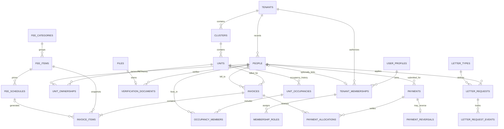

# Data model

Terminology follows the [terminology and naming standard](00-terminology-and-naming.md).

This is the original logical design baseline. The **Neon application schema has now been migrated**; the [deployed Neon schema reference](16-neon-database-schema.md) and `db/migrations/*.sql` define the actual table names, identity integration, constraints and access model. Supabase-specific references below are historical planning details and are superseded by that implementation.

## 1. Terminology and changes from the initial sketch

| Initial concept | Final representation | Reason |
| --- | --- | --- |
| `unit` and `housing` | One `units` entity | They describe the same physical home; avoid competing owner/occupant fields |
| `clusters.units` | `units.cluster_id` | Store the relationship once; query a cluster's units |
| `housing.owner` | Dated `unit_ownerships` rows | Supports transfers, co-owners, and non-resident owners |
| `housing.current_occupants` | Active `unit_occupancies` + `occupancy_members` | Preserves move history and supports more than one occupant |
| `owner_phone`, `occupants_phone` | Contacts on `people`; read through relationships | Avoid stale copies and allow people without accounts |
| `resident.cluster`, `resident.unit` | Relationships through occupancy and ownership | One person can live in or own more than one unit over time |
| `verification_docs.id_card/family_card/other` | One row per document with type, private file, and review | Supports replacement, review status, and more than one supporting document |
| Future tenants | `tenants` and `tenant_id` on neighborhood data | Add a second customer without reinterpreting all records |

Do not store `current_owner`, `current_occupants`, or a single editable `occupied/rented` status as independent sources of truth. Derive current views from dated relationships.

## 2. Core relationships

The diagram omits utility/attachment tables for readability. All displayed neighborhood relationships are additionally constrained by `tenant_id`.

## 3. Shared conventions

- IDs: opaque UUIDs. A random ID is an identifier, not an authorization mechanism.
- Every neighborhood-owned table has a non-null `tenant_id`; exceptions are global `auth.users`, `public.user_profiles`, and private account/session controls. `tenants.id` is the tenant root.
- Use UTC timestamps for events and a configured neighborhood timezone for displays and due-date calculations. Business effective periods use local dates, with start inclusive and end exclusive: `[start_date, end_date)`; null end means ongoing.
- Money: exact `numeric(18,2)` plus currency on invoices/payments. Never floating point. Pilot policy: IDR only, line totals rounded half up to whole rupiah. Quantities and rates may need more decimal precision than totals.
- Mutable records have `created_at`, `updated_at`, and a version for conflict detection. Important actions record the actor. Status values are controlled enums, not arbitrary text.
- Archive reference records; do not cascade-delete issued invoices, payments, ownership/occupancy history, or audit events. Personal-file deletion follows an agreed retention process and preserves only necessary audit metadata.

## 4. Identity and neighborhood structure

| Entity | Important fields and rules |
| --- | --- |
| `tenants` | `id, name, slug, timezone, locale, currency, status`; one neighborhood per tenant initially |
| `auth.users` | Supabase-managed account and login identifiers; use its primary key only for application references; no duplicate credentials table |
| `public.user_profiles` | `id` referencing `auth.users.id`; `display_name?, created_at, updated_at`; global account display data only |
| `private.account_controls` | `user_id, status, must_change_password, credential_version, provisioned_by, provisioned_at`; server-controlled account gates |
| `private.app_sessions` | `session_id, user_id, credential_version, authenticated_at, revoked_at?`; server-controlled session authorization |
| `tenant_memberships` | `tenant_id, user_id, person_id?, status, joined_at`; unique `(tenant_id, user_id)` and unique non-null `(tenant_id, person_id)`; staff need not have a resident person record |
| `role_assignments` | `tenant_id, membership_id, role, starts_at, ends_at, assigned_by, assigned_at, appointment_reason, revoked_at?, revoked_by?, revocation_reason?, renews_assignment_id?`; dated, nonoverlapping per membership/role; fixed staff permissions |
| `platform_role_assignments` | `user_id, role(super_admin), starts_at, assigned_by, assigned_at, reason, revoked_at?`; no expiry/tenant; protected platform operations only |
| `membership_permissions` | `tenant_id, membership_id, role_assignment_id, permission`; unique `(tenant_id, role_assignment_id, permission)`; explicit sensitive capability such as `review_verification_documents`, granted by Super Administrator and bounded by the eligible parent appointment |
| `invitations` (post-MVP) | `tenant_id, target_person_id?, intended_contact, role, token_hash, expires_at, accepted_at, invited_by`; one-use, expiring; existing accounts can accept after verification |
| `clusters` | `tenant_id, name, code, archived_at`; unique normalized cluster code and normalized name per tenant, including archived records; archive prevents new unit/fee assignments while preserving existing references and billing |
| `units` | `tenant_id, cluster_id, unit_number, address_detail?, archived_at`; unique `(tenant_id, cluster_id, normalized_unit_number)` |
| `people` | `tenant_id, full_name, phone?, email?, archived_at`; phone numbers and email addresses are contact data and may be shared; no assumed global deduplication |
| `unit_ownerships` | `tenant_id, unit_id, person_id, start_date, end_date?, is_primary_contact, verification_status`; multiple co-owners possible, one designated primary owner contact at any date |
| `unit_occupancies` | `tenant_id, unit_id, occupancy_type(owner_occupied/rented/caretaker/other), start_date, end_date?`; one active occupancy group per unit in the pilot |
| `occupancy_members` | `tenant_id, occupancy_id, person_id, start_date, end_date?, is_primary_contact`; individual move dates must fit inside the occupancy period |
| `unit_access_grants` | `tenant_id, unit_id, person_id, permission, basis, source_ownership_id?, source_occupancy_member_id?, valid_from, valid_until?, granted_by`; narrowly scoped current household permissions |

The [role and election-term contract](07-roles-and-terms.md) defines active-role predicates, renewal history, platform scope, and privileged-account protection. Resident access derives from active membership and housing/invoice grants, independently of staff appointments.

Account provisioning, login identifier changes, and password resets are performed through server-authorized neighborhood administrator actions. Supabase confirmation flags used to enable sign-in do not prove that the person controls the phone number or email address. Keep manual approval metadata distinct from future channel verification. The `must_change_password` flag is server-controlled; access policies restrict protected data until it is cleared by a successful password-change workflow. No plaintext password is persisted or included in audit events.

Global authentication data is accessible only to the authentication/account service. A neighborhood administrator must not be able to enumerate accounts or discover another neighborhood's membership. A person may have separate local records in multiple neighborhoods linked to the same user, without merging private profile data between customers.

Period constraints:

1. `end_date > start_date` when an end is provided. Reject overlapping occupancy groups for the same unit, including future-dated periods.
2. Reject overlapping duplicate memberships for the same person within an occupancy. A primary occupant contact must be an active member; allow at most one at a time.
3. Allow multiple co-owners but at most one active primary owner contact. Flag occupied units without a designated contact as incomplete.
4. Closing an occupancy closes or validates its member periods atomically. Opening a replacement does not overwrite the previous residents.
5. A relationship-based grant cannot outlive its underlying ownership/occupancy relationship. Re-evaluate access against effective dates on every request. Explicit manual grants require an expiry/revocation policy.

## 5. Files and verification

| Entity | Important fields and rules |
| --- | --- |
| `files` | `tenant_id, storage_key, original_name, mime_type, byte_size, checksum, purpose, uploaded_by, scan_status, created_at, deleted_at?`; unique storage key; no public identity-document URL |
| `verification_documents` | `tenant_id, person_id, unit_id?, document_type(id_card/family_card/occupancy_evidence/other), file_id, status, submitted_by, reviewed_by?, reviewed_at?, rejection_reason?, supersedes_id?` |

A document belongs to a person and may additionally support a relationship to a unit. Do not attach a family card to every family member. Do not treat the verification table as a general gallery. Review states: `submitted → approved/rejected`; replacements create a new version rather than overwriting the reviewed evidence.

National ID numbers, full birth dates, document OCR, and extra family details are not default requirements. Add them only when a confirmed letter or verification process needs them. Identity documents, payment proof, letter evidence, and public news images have separate purposes and authorization rules. Reusing a private file as public media must be rejected.

## 6. Billing and payments

| Entity | Important fields and rules |
| --- | --- |
| `fee_categories` | `tenant_id, code, name, is_active`; administrator-defined categories; tenant-unique code; no fixed enum |
| `fee_items` | `tenant_id, category_id, code, name, description?, is_active`; administrator-defined chargeable items; unique code per tenant |
| `fee_schedules` | `tenant_id, fee_item_id, scope_type(tenant/cluster/unit), cluster_id?, unit_id?, amount, recurrence(monthly/one_time), charge_date?, effective_from, effective_to?, due_rule, payer_rule, vacancy_rule, version`; mutually valid scope columns; version when rates change |
| `unit_billing_responsibilities` | `tenant_id, unit_id, fee_item_id, person_id, start_date, end_date?, basis, approved_by`; resolves the actual bill-to person; nonoverlapping per unit/item in pilot |
| `invoices` | `tenant_id, unit_id, bill_to_person_id, invoice_number, period_start, period_end, issue_date, due_date, currency, bill_to_name_snapshot, unit_label_snapshot, status(draft/issued/void), total_amount, issued_at?, void_reason?, replaces_invoice_id?` |
| `invoice_participants` | `tenant_id, invoice_id, person_id, permission(view/submit_payment), basis, granted_by`; snapshot authorized bill-to/delegates when issued; later residents do not inherit this access |
| `invoice_items` | `tenant_id, invoice_id, fee_item_id, fee_schedule_id?, item_name_snapshot, category_name_snapshot, description_snapshot, quantity, unit_rate, line_amount, charge_key`; snapshots pricing; unique non-null generated `charge_key` per tenant |
| `payments` | `tenant_id, unit_id, bill_to_person_id, submitted_by, method(bank_transfer/cash), amount, currency, claimed_paid_at, bank_reference?, cash_collector?, proof_file_id?, status(submitted/verified/rejected), verified_by?, verified_at?, rejection_reason?, client_submission_key, supersedes_payment_id?` |
| `payment_allocations` | `tenant_id, payment_id, invoice_id, amount`; requested allocations may be stored at submission, but only verified/unreversed ones count toward settlement |
| `payment_reversals` | `tenant_id, payment_id, amount, reason, reversed_by, reversed_at`; one full reversal per verified payment in pilot; amount equals the original payment amount |
| `payment_events` | `tenant_id, payment_id, event_type, actor_id, occurred_at, reason?`; immutable submission/review/correction trail |

Billing invariants:

- An invoice has one unit, one bill-to person, and one currency. Split invoices if different items have different responsible people.
- The server resolves responsibility for the billing period and snapshots it. Missing responsibility blocks issuance; a resident is not selected merely because their phone is the first available.
- Fees with overlapping scopes use a documented precedence (`unit > cluster > tenant`) and may not accidentally charge the same item occurrence twice. Distinct intentional charge items require distinct keys.
- A generated `charge_key` identifies the unit, fee item occurrence, and billing period independently of job retries. Retain uniqueness even after voiding; an explicit replacement action creates a new revision and preserves its original linkage.
- Line amounts sum exactly to the invoice total. Issuance freezes amounts, descriptions, dates, unit label, and bill-to details. Live contact details may still be resolved for communication.
- Invoice numbers and issued-letter reference numbers are unique per tenant, allocated atomically using the agreed numbering format. Drafts need not consume an official number.
- Submission amounts and allocations are positive. All target invoices must belong to the payment's unit, bill-to person, tenant, and currency, and the submitting account must be authorized for them.
- On verification, lock the relevant invoice/payment rows and revalidate outstanding balances. Count a payment once. Sum of effective allocations cannot exceed its verified amount or any invoice's remaining balance.
- `unapplied_amount = verified_payment_amount − effective_allocations`; reversals remove the entire payment's effective allocations. A duplicate receipt suspicion goes to review; repeated bank references are a signal, not universally valid unique keys.
- A unique `(tenant_id, submitted_by, client_submission_key)` prevents accidental repeat submissions from a double tap. Rejected payment submissions remain visible; a correction is a new linked submission, not an untracked overwrite.
- No separate mutable `is_paid` flag. Derive settlement as unpaid/partially_paid/paid. Overdue is a date-based flag, not a competing settlement state.
- Overpayments and already-paid-invoice submissions go to an exception workflow. Reallocation after verification needs explicit, audited handling; automatic refunds and credit notes are deferred.

Required MVP metered-water data (see [billing update](09-billing-cash-media-update.md)): `meters`, `meter_readings`, and effective-dated `water_tariffs`; snapshot reading IDs, consumption, tariff version, and calculation onto the invoice item. Reject decreasing readings unless an explicit meter-reset/replacement event explains them.

## 7. Communications, content, and services

| Entity | Important fields and rules |
| --- | --- |
| `communication_preferences` | `tenant_id, person_id, channel, purpose, opted_in_at?, opted_out_at?, evidence_reference?`; separate consent from having a contact number |
| `reminder_templates` | `tenant_id, name, version, channel, body, allowed_variables, is_active, provider_template_id?`; version sent/prepared text |
| `reminder_attempts` | `tenant_id, invoice_id, recipient_person_id, destination_snapshot, template_id, template_version, channel, status, prepared_by, prepared_at, provider_message_id?`; manual states never imply provider delivery |
| `posts` | `tenant_id, title, slug, body, type(news/event/announcement), audience(public/residents/cluster), status(draft/published/archived), author_id, published_at?, event_starts_at?` |
| `post_audience_clusters` | `tenant_id, post_id, cluster_id`; used only for cluster-targeted posts |
| `post_media` | `tenant_id, post_id, file_id, caption?, sort_order`; audience inherits from post |
| `contact_entries` | `tenant_id, category, display_name, public_phone?, whatsapp?, service_hours, visibility(public/residents), last_checked_at, is_active`; role contacts are preferable to exposing private staff numbers |
| `service_requests` | `tenant_id, requester_person_id, unit_id?, category, subject, description, location_text?, priority, status, assigned_membership_id?, created_at, resolved_at?` |
| `service_request_updates` | `tenant_id, service_request_id, actor_id, message, visibility(requester/internal), status_change?, created_at`; attachments have matching visibility |
| `letter_types` | `tenant_id, code, name, required_fields_schema, required_evidence, signatory_label, version, is_active`; version requirements so old applications retain their original form |
| `letter_requests` | `tenant_id, type_id, type_version, applicant_person_id, unit_id?, form_snapshot, status, assigned_membership_id?, submitted_at?, approved_by?, reference_number?, issued_file_id?, issued_at?` |
| `letter_request_events` | `tenant_id, letter_request_id, actor_id, event_type, message?, visibility(applicant/internal), created_at`; includes revisions and applicant-visible status history |
| `guest_reports` | `tenant_id, host_person_id, unit_id, guest_name, expected_from, expected_until, vehicle_plate?, note?, status, acknowledged_by?`; notification only in first release |
| `audit_events` | `tenant_id, actor_user_id?, action, entity_type, entity_id, redacted_change_summary, occurred_at, request_id`; append-only; never store passwords/tokens or full document bodies |

Use explicit attachment join tables for service requests, service request updates, and letter requests. Attachments inherit their parent record's tenant, audience, and access checks. Proposed later tables include `post_reactions` with unique `(tenant_id, post_id, person_id)` and event registrations; they need not be built for the pilot.

## 8. Tenant and query integrity

Add unique `(tenant_id, id)` keys on referenced neighborhood records and use composite foreign keys such as `(tenant_id, unit_id) → units(tenant_id, id)`. Apply this to every relationship, including files, memberships, invoice participants, and attachment tables. This prevents storing a valid ID from the wrong neighborhood.

Every query, background job, export, and file request operates inside server-validated tenant context. Tenant selection from the client is only a selector; current membership authorizes it. Storage prefixes and cache/job keys include the tenant but are not substitutes for access checks. These choices follow the [OWASP multi-tenant guidance](https://cheatsheetseries.owasp.org/cheatsheets/Multi_Tenant_Security_Cheat_Sheet.html).

Recommended indexes start with `tenant_id`, followed by common filters: unit label, normalized person search/contact, effective relationship dates, invoice due date/status, payment review status, and service status/assignee. Add indexes based on actual query plans and pilot volume rather than indexing every column.

## 9. Example: occupant changes without losing history

Unit A-12 is owned by Sari. Budi rents it from 1 January through 30 June; Dewi moves in on 1 July.

- Sari's ownership record continues. Budi's occupancy group ends on `2026-07-01`; Dewi's begins that day. This is one clear boundary, with no overlapping occupancy.
- June invoices issued to Budi stay linked to Budi and retain their issued contact/name snapshot. Dewi does not gain access to them.
- July responsibility resolves using the agreed fee rules and effective billing-responsibility records. Security dues could be Dewi's while a property-related fee remains Sari's.
- A June transfer submitted by Budi and verified in July settles June's invoice. It is counted in the July verification-date collection report and in June's invoice-cohort collection rate.
- Budi retains access to his own previous invoices and receipts, but no current household details or Dewi's verification documents.

Cash ledger, administrator-recorded payment provenance, template variables, and news-image requirements are expanded in the [billing/cash update](09-billing-cash-media-update.md). The production schema must use tenant-scoped references and protected transactional writes for these features.

The [assessment and bulk-issuance update](10-assessments-bulk-invoices.md) adds proposed/verified payment allocations per invoice item, explicit reconciliation for unknown historical allocation, protected bulk creation scopes, and individual-invoice exports. Stable invoice-item IDs and transactional per-item balance checks are required in production.

## Resident contact and occupancy update

Each person record needs a phone number and an optional HTTPS document storage URL for scanned documents. Owners and current occupants keep separate contact/document references. Occupancy transitions preserve the previous person, period, and document reference, with administrator/time metadata; they do not rewrite invoice snapshots or account/role assignments. The local prototype stores compatible optional owner/occupant fields on its existing unit records; production retains the normalized person and occupancy relationships described above. See [12-residents-and-template-editor.md](12-residents-and-template-editor.md).
