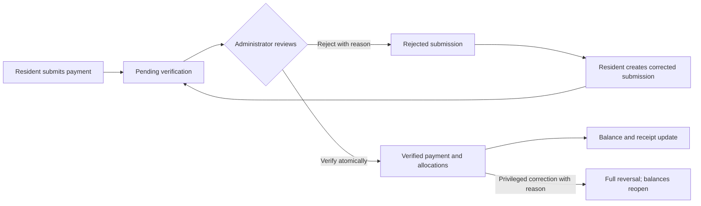
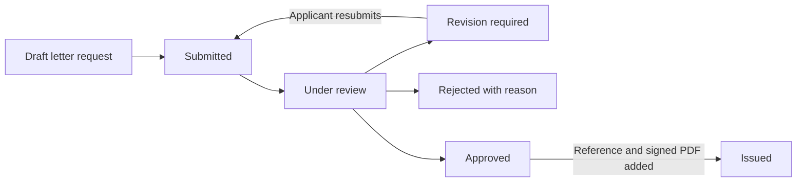

# Experience and screen design

Terminology follows the [terminology and naming standard](00-terminology-and-naming.md).

Finalized low-fidelity screen specification. All names, unit numbers, and amounts in wireframes are fictional examples; they are not neighborhood records or agreed fee rates.

## 1. Product structure

Use one responsive application with three entry points: public neighborhood pages, the resident portal, and the administration workspace. People holding both resident and staff permissions can switch workspaces explicitly. Do not mix private administrative queues into the resident home screen.

| Public | Resident | Administration |
| --- | --- | --- |
| Landing/about | Home | Dashboard |
| Public news and events | My unit and occupants | Residents and units: units, people, ownership, occupancy |
| Public contacts | Invoices, invoice details, payment submission/history | Billing: schedules, invoices, payment review, reminders, reports |
| Sign in | News | Content: posts and media |
| Account help (contact administrator) | Services: resident letters, contacts, service requests, guest reports | Services: resident letters, service requests, guest reports, contacts |
| | Account and communication preferences | Settings: neighborhood, staff, roles, user accounts, templates, audit/imports |

Resident mobile bottom navigation: **Home · Invoices · News · Services · Account**. Put unit selection in the header only when the account has more than one authorized unit. Staff see a sidebar on desktop and a navigation drawer on mobile.

## 2. Design direction

- Calm, practical interface with neutral surfaces, a restrained green/teal primary action, and strong text contrast. Use icons alongside labels, never in place of essential text.
- Use familiar Indonesian labels if that locale is confirmed: `Warga`, `Unit`, `Tagihan`, `Kirim konfirmasi pembayaran`, `Ajukan surat`, and `Layanan`.
- Explain payment state in plain terms: “Pending verification” rather than presenting a pending payment submission as paid.
- Display a unit consistently as `Cluster / Unit number`. Distinguish owner, current occupants, primary contact, and bill-to person wherever relevant.
- Use dates, status labels, and amounts consistently. Pair status color with visible text. Do not expose overdue residents in a public list or leaderboard.
- Tables suit administrator comparison; mobile views use labeled rows/cards with the same essential actions. Pagination and server filtering support larger directories.
- Forms use visible labels, field-level errors, a summary for failed submission, and preserved input after errors. Important status changes provide a clear confirmation.

Suggested product tokens: 16px base text, a 4/8px spacing scale, minimum 44px touch targets, and readable line lengths. Final colors and typography should be validated for WCAG 2.2 AA contrast and keyboard access during implementation; compliance is not established by this proposal.

## 3. Desktop administration dashboard

```text
┌────────────────────┬───────────────────────────────────────────────────────┐
│ Proomahan   / Neighborhood name                    [Administration workspace ▾]│
├────────────────────┼───────────────────────────────────────────────────────┤
│ Dashboard          │ Overview                [Period ▾] [Cluster ▾]        │
│ Residents and units│                                                       │
│ Billing            │ Occupancy       Outstanding       Verified collections│
│ Content            │ [count / units] [IDR amount]      [IDR amount]        │
│ Services           │                                                       │
│ Settings           │ Needs attention                                       │
│                    │ Pending verification [count]   [Review payments]      │
│                    │ Resident verification    [count]   [Review records]   │
│                    │ Letter requests          [count]   [Open requests]    │
│                    │                                                       │
│                    │ Recent activity                                       │
│                    │ Action / unit / actor / timestamp                     │
└────────────────────┴───────────────────────────────────────────────────────┘
```

Dashboard cards link to the filtered records behind each total. Show each metric only to staff with its permission. Label financial date basis: billing period for charges/outstanding; verification date for collection cash flow. Empty states provide a next action such as “Add the first unit” or “Configure fees.”

## 4. Residents and units management

Directory columns: cluster, unit, occupancy, occupancy type, primary owner, primary occupant contact, verification completeness. Filters: cluster, occupied/vacant, occupancy type, and verification status. People search is a separate view, since one person can relate to multiple units.

Unit details use tabs:

1. **Overview:** physical address, current owner(s), occupancy status/type, and designated contacts.
2. **People and history:** dated ownership and occupancy periods with clear move-in/move-out actions.
3. **Billing:** only for users with billing permission; show responsibility by fee item and linked invoices.
4. **Documents:** only for authorized verification reviewers; never a general household document gallery.
5. **Activity:** relevant audited changes with sensitive fields redacted.

“Change occupants” opens an effective-date form showing who loses/gains current household access and whether billing responsibility needs review. “Transfer ownership” is a different action. Both show a before/after summary and reject invalid overlapping dates.

## 5. Resident home on mobile

```text
┌────────────────────────────────────────┐
│ Neighborhood name      [Account]       │
│ My unit: Cluster A / A-12     ▾        │
│                                        │
│ Your invoices                          │
│ Rp125,000 outstanding                  │
│ Rp75,000 pending verification          │
│ [View invoices]                        │
│                                        │
│ My unit                                │
│ Rented · occupancy verified            │
│ [View authorized unit details]         │
│                                        │
│ Services                               │
│ [Request a letter] [Submit request]    │
│ [Gate security]    [Contacts]          │
│                                        │
│ Neighborhood update                    │
│ Community clean-up · 10 Nov            │
│ [Read update]                          │
├────────────────────────────────────────┤
│ Home  Invoices  News  Services  Account│
└────────────────────────────────────────┘
```

The selected unit is a navigation context, not a permission grant. Always identify it on invoice and service forms. If the resident has no approved unit relationship, show onboarding/review progress and support contacts instead of another unit's data.

## 6. Invoice and payment design

Invoice details show invoice number, unit, bill-to name, period, issue/due date, itemized charges, verified payments, pending submissions, and remaining balance. Payment history includes verification and rejection reasons where appropriate.

```text
Invoice INV-2026-0012 · Cluster A / A-12
November 2026 · Billed to: Budi

Community dues            Rp50,000
Cleaning fee              Rp50,000
Security fee              Rp50,000
Water charge              Rp25,000
Total                    Rp175,000
Verified payment          Rp50,000
Outstanding balance      Rp125,000

Pending verification     Rp75,000
The outstanding balance updates after verification.

[Submit payment]   [View payment history]
```

Payment form:

| Bank transfer | Cash |
| --- | --- |
| Official receiving account, displayed read-only | Designated collector/contact instructions |
| Amount and payment date | Amount and cash handover date |
| Reference and required proof upload | Collector name/reference; receipt photo if available |
| Selected authorized invoice allocation | Selected authorized invoice allocation |

After submission, show “Payment submission received — pending verification,” a submission reference, and a link to history. Disable duplicate taps during submission while allowing safe retry after a network failure.

Administrator review uses a queue and a detail view. Show the invoice balance, submission, evidence, prior payment submissions, potential duplicates, and receiving-account/collector reference together. Provide **Verify** and **Reject with reason**. If another administrator has already acted, refresh the record and explain the conflict. A payment submitted by the same staff member should require a different verifier where staffing allows; define the small-team exception explicitly.

Reminder review shows recipient, consent/preference, invoice, due date, current balance, and any pending payment before **Open WhatsApp**. The history labels manual actions accurately and offers “Already paid — review submission” when needed.

## 7. Service screens

**Letters:** A list shows type, submitted date, status, last update, and reference number when issued. The detail view contains the submitted fields, applicant-visible timeline, revision response form, and issued PDF download. Staff see a separate internal-notes area and actions appropriate to the current state. “Issued” is only available once a reference and approved file exist.

**Service requests:** Category, description, optional location/photo, and contact preference. The resident sees their own service request list and progress. Staff assign, respond, resolve with a summary, and reopen where appropriate. A resident event/news suggestion requires editorial review before publication.

**Contacts:** Category cards show service role, phone/WhatsApp, hours, and **Call** / **Open WhatsApp**. The gate card says **Contact gate security**; it does not show an electronic “Open gate” action.

**Guest reports:** A short form for guest name, destination unit, expected window, and optional vehicle. A manual acknowledgement is visible to the host. This does not promise that the gate will open or that a guest was admitted.

## 8. Workflow states





Applicants can cancel a draft, submitted, or revision-stage request under a confirmed cancellation policy. Issued letters remain preserved; any withdrawal or correction is an audited service action rather than a silent file replacement.

Other state sets:

- Service requests: `submitted → acknowledged → in_progress → resolved → closed`, with an audited reopen path.
- Posts: `draft → published → archived`; audience changes re-evaluate media access.
- Guest report: `reported → acknowledged`, or `cancelled`; checked-in/out states are deferred until a visitor-log workflow is confirmed.
- Invoice lifecycle: `draft → issued → void` where permitted. Settlement (`unpaid/partially_paid/paid`) and overdue flags are calculated separately.

## 9. Responsive and accessibility behavior

- At narrow widths, replace sidebars with a drawer and dense record tables with labeled lists. Keep invoice line items readable without compressing the amounts.
- Preserve filters and selected unit when navigating back. Show applied filters and distinguish “no records” from “no matching records.”
- Support keyboard navigation, visible focus, screen-reader labels, accessible status updates, and browser zoom. Charts have a table/text equivalent.
- Show upload progress and server-confirmed success. File validation errors explain allowed type/size; an interrupted upload must not create a verified or issued record.
- A session expiry preserves non-sensitive draft fields where safe, then asks the user to sign in. Identity-card previews and bank proof are not cached offline.
- Any future installable PWA caches only the public shell and approved public content initially; private screens require live authorization.

## 10. Design validation before implementation

Test the wireframes with an administrator and residents on their actual phones. Ask them to find their outstanding invoice, submit cash payment details, distinguish pending from verified, request a revised letter, and contact gate staff. Record where labels or next steps are unclear. Refine these core flows before producing polished visual mockups or building secondary features.

## 11. MVP account administration

The Resident Administrator uses **User accounts** to create ordinary local resident accounts, link an approved person, approve or change login identifiers, reset a password, and deactivate ordinary access. Super Administrator accounts and credentials are excluded. The **Peran dan masa jabatan** screen is Super Administrator-only: appoint an active resident, set start/end timestamps, renew with a new period, or revoke with a reason. The resident portal remains available after an elected term ends while ordinary membership/relationships remain valid. See [roles and election terms](07-roles-and-terms.md). Account creation and reset show a generated temporary password once for manual handover; passwords are not visible later. Audit events identify the administrator, target account, and action, without recording passwords.

The sign-in screen accepts a phone number or email address and a password, with **Contact administrator** for access help. There is no public registration, verification-code screen, or email reset link in the MVP. First sign-in after account creation/reset requires a password change before protected records are accessible. Administrative approval is labeled **Administrator approved**, rather than **Email verified** or **Phone verified**.

## 12. Fee configuration screens

Under **Billing**, use **Fee categories**, **Fee items**, **Fee schedules**, **Invoices**, **Payments**, **Payment reminders**, and **Reports**. Categories group items; each item can have multiple effective-dated schedules. The administrator can create/rename/archive categories and items without a code change.

The schedule editor requires an item, monthly or one-time frequency, amount, neighborhood/cluster/unit scope, effective dates, due-date rule, payer selection, and vacancy treatment. A unit override takes precedence over a cluster override, which takes precedence over a neighborhood schedule for the same item occurrence. Different items in the same category remain billable independently.

Show **Preview invoices** before **Issue invoices**, including the item/rate source, responsible person, exceptions, and total. No preset amounts are implied by example data. Editing a schedule explains that issued invoices retain their original values. Full configuration rules are in the [MVP implementation specification](05-mvp-implementation-specification.md).

## 13. Cluster management

Use **Warga dan unit → Kelola klaster** for Super Administrator and active Resident Administrator appointments. Manage a neighborhood-unique cluster code and name, view total/occupied/vacant units and their owner/occupant summaries, archive, and restore. Search and active/archived filters apply to the managed list. Mobile renders cluster cards with visible actions; desktop uses a table.

Archive removes a cluster from new unit and new cluster-fee choices without deleting units or cancelling existing fees. Existing archived fee scopes remain editable without changing their target. Archived clusters remain searchable/filterable in the unit directory. Renaming is reflected in current unit labels, filters, resident summaries, and fee-scope labels; issued financial snapshots and unit numbers do not change. Duplicate names (ignoring case/extra whitespace) and codes (normalized uppercase) are rejected even against archived records. No permanent delete is offered.

## 14. Unified billing workspace

Use one administration menu item, **Tagihan**. The monthly landing lists residents/units with iuran, water, total issued amount, remaining amount, and settlement. Provide month, resident/unit search, and status filters. Header **Buat tagihan** opens two choices: **Tagihan iuran** and **Tagihan air**. Resident-row **Detail** offers the same bill types, scoped to that unit/month. Show a creation action for a missing bill and details for an issued bill. Keep meter entry inside its creation dialog.

General dues can be previewed for all units or one selected unit. Both creation flows return to the selected month after issuance. Quick WhatsApp/payment actions select the applicable type/invoice, preserving pending-payment checks. Mobile cards expose both charge summaries and all row actions. Existing combined invoices are labeled and counted once in total/settlement calculations.
