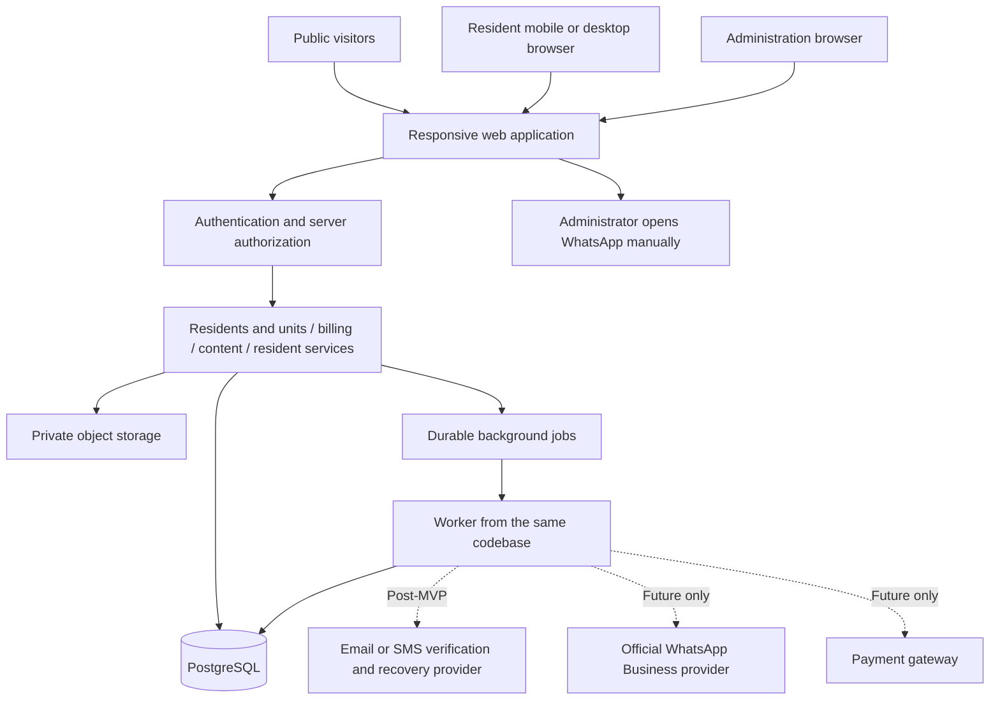

# Architecture and delivery plan

Terminology follows the [terminology and naming standard](00-terminology-and-naming.md).

This document defines the implementation baseline and development order. Use Next.js App Router with TypeScript, Tailwind CSS, shadcn/ui, and Supabase PostgreSQL/Auth/Storage. Deployment credentials, hosting account, actual launch date, and operating targets are launch inputs. The [MVP implementation specification](05-mvp-implementation-specification.md) defines the detailed contracts.

## 1. Recommended architecture

Start with a modular monolith: one deployable web application, clear feature modules, one relational database, and a worker from the same codebase. It gives billing transactions and permissions a single place to operate while keeping operating overhead manageable for one neighborhood.

| Layer | Implementation baseline | Rationale |
| --- | --- | --- |
| Client | Responsive browser UI shared by desktop/mobile | One product and authorization model; separate native apps are unnecessary for pilot scope |
| Server | Next.js App Router + TypeScript | Shared public, resident, and administration application with server-side actions |
| Database | Supabase (PostgreSQL), confirmed | Relational constraints, transactional verification, and mandatory Row Level Security (RLS) on exposed application tables |
| Authentication | Supabase Auth with phone number/email address and password; server-side administrator provisioning and resets | No email/SMS verification, public registration, or automated recovery for the MVP |
| Files | Supabase Storage private buckets with short-lived authorized downloads | Keeps identity evidence, payment proof, and issued letters behind access checks |
| Worker | Database-backed job queue initially; same domain code | Handles imports, exports, recurring invoice previews, and notifications without requiring a separate cache service |
| Operations | Separate staging/production; automated deployment checks, backups, logs, and error monitoring | Allows safe verification and recovery without using production residents in testing |

Redis, microservices, native apps, and a separate search engine can wait for a measured need. Choose exact language/framework versions when implementation starts and verify their current supported releases then.

## 2. Tenant boundaries from the first migration

Provision one neighborhood with an administrator-only setup process. The first interface can hide tenant switching when there is only one membership. Do not hardcode the neighborhood ID into the business logic.

Tenant context comes from a server-verified membership; the client cannot create authority by changing a tenant header or URL. All database references, file authorization, cache keys, exported files, and worker payloads carry that context. Jobs revalidate the relevant authority and record their actor or service identity. Use synthetic data from a second tenant in tests before onboarding a second customer. These are design applications of [OWASP's tenant-isolation guidance](https://cheatsheetseries.owasp.org/cheatsheets/Multi_Tenant_Security_Cheat_Sheet.html).

Use PostgreSQL row-level security alongside server authorization. Validate membership against `auth.uid()` and current database records, and test with the real runtime role. Do not trust a client-set tenant variable. Table owners and `BYPASSRLS` roles can bypass normal policies, so the application must not run requests under those roles. See [PostgreSQL row security](https://www.postgresql.org/docs/current/ddl-rowsecurity.html).

Future onboarding adds tenant provisioning, per-neighborhood configuration, membership switching, and commercial administration. It should not require moving every existing resident into a new data structure. If one customer later manages several neighborhoods, introduce an organization layer then; do not assume that requirement today.

## 3. Module and action boundaries

| Module | Owns | Important actions |
| --- | --- | --- |
| Identity/access | Accounts, memberships, dated staff appointments, platform Super Administrators | Create account, approve login identifier, reset password, deactivate ordinary access; Super Administrator appoints/renews/revokes roles |
| Residents and units | Clusters, units, people, ownership, occupancy | Import preview, approve relationship, transfer owner, move occupants |
| Billing | Fee schedules, responsibility, invoices, payments, reminders | Preview generation, issue invoice, submit/verify/reject payment, reverse correction |
| Content | Posts, audiences, media | Publish, change audience, archive |
| Resident services | Resident letters, service requests, contacts, guest reports | Review letter, request revision, issue letter, respond to service request |
| Shared operations | File access, audit, jobs, exports | Authorize download, record audit action, generate scoped export |

Expose explicit server actions for important transitions rather than allowing arbitrary record-status updates. Examples: `preview invoices`, `issue invoice`, `verify payment`, `close occupancy`, and `issue letter`. Each action validates tenant, permission, record state, input, and concurrency before committing a transaction.

For generation and verification, persist the domain update and its follow-up job/outbox event in the same transaction. Failed notification delivery must not undo a valid payment or cause it to be applied twice. Retry jobs with bounded attempts, deduplication, and a visible failure queue.

Authorization evaluates current dated assignments at every protected operation, including RLS, Storage/downloads, workers, and exports; an unexpired JWT does not extend a term. See [roles and election terms](07-roles-and-terms.md) for the authoritative contract and new verification gates.

## 4. Account and document controls

MVP accounts are managed manually by neighborhood administrators. Retain password hashing, throttling, generic sign-in errors, secure sessions, authorization, and audit logging. Email/SMS verification, automated recovery, and MFA are deferred. Resident-document review and payment verification remain separate MVP workflows.

Use Supabase Auth's server-side [createUser](https://supabase.com/docs/reference/javascript/auth-admin-createuser) and [updateUserById](https://supabase.com/docs/reference/javascript/auth-admin-updateuserbyid) operations for the provisioning/reset flow. The server confirms the administrator's current neighborhood role and target-account scope before invoking privileged operations. Administrative confirmation can allow password sign-in without sending a channel-verification message; it must not be labeled proof of phone/email ownership. Disable public sign-up in the authentication configuration as well as omitting the registration screen. Keep privileged credentials exclusively on the server.

Provide a generated temporary password manually and require a password change before protected data access. This restriction is application policy, enforced server-side and in database/storage access policies, not an assumed built-in Supabase setting. Password resets require the administrator to check the resident's identity through existing neighborhood records, record the action without the password, and invalidate previous application access. Establish and test session revocation before implementation is considered complete. Changing a resident contact field does not automatically change the login identifier.

For files, allow only required types, validate extension and actual content, limit size, generate storage names, restrict uploaders, and quarantine pending inspection. Authorize downloads against the current parent record; a storage prefix or guessed file ID alone grants no access. Avoid long-lived public links for private files. These controls follow [OWASP file-upload guidance](https://cheatsheetseries.owasp.org/cheatsheets/File_Upload_Cheat_Sheet.html).

Before production, agree the minimum collected identity data, privacy notice, role access, retention/deletion rules, and export authority with the neighborhood's responsible administrator. Keep production documents out of developer fixtures, logs, and error payloads. Verify backup restore and file restore together, rather than assuming database backup alone restores the service.

## 5. Delivery stages and completion gates

The order matters more than the calendar. A preliminary planning range is **10–14 weeks** for one experienced full-stack developer with part-time design/QA and a responsive neighborhood administrator. This is a scope-based estimate, not a quote; import quality, auth-provider capabilities, letter rules, and water billing can materially change it.

| Stage | Indicative effort | Output | Completion gate |
| --- | --- | --- | --- |
| 0. Confirm operations and design | 1 week | Fee examples, role list, letter samples, redacted import sample, reviewed wireframes | Business owner resolves pilot policy questions; screens match actual work |
| 1. Foundation | 1–2 weeks | Application shell, migrations, tenant context, sign-in and administrator-assisted resets, role checks, private uploads, audit | Phone number and email address sign-in flows work with a password; second-tenant access checks fail safely |
| 2. Residents and units directory | 2 weeks | Clusters/units, people, dated ownership/occupancy, administrator account creation, document review, import preview | Owner/renter/move-out examples pass; invalid overlaps and duplicate units are blocked |
| 3. Complete billing cycle | 3–4 weeks | Fee configuration, preview/issue, resident submission, staff verification, receipt, reports, manual reminders | Sample ledger reconciles; partial/rejected/duplicate/concurrent payments behave correctly |
| 4. Content and services | 2–3 weeks | News and media, resident services, service requests, letters, basic guest report | Public/private audiences work; private resident letters and service requests remain scoped; gate contact matches manual operation |
| 5. Pilot and hardening | 1–2 weeks | Import reconciliation, usability checks, operational recovery, staff guide | Administrators and residents complete real workflows; restore and rollback checks pass |

The stage ranges total 10–14 weeks with the proposed staffing and scope. Re-estimate after Stage 0; no launch date has been selected.

Recommended implementation backlog order:

1. Agree tenant, account, person, unit, and role vocabulary; confirm fee responsibility rules.
2. Establish server authorization, tenant-aware references, audit, and secure file handling.
3. Deliver one complete person/unit account-provisioning flow, then dated changes and import.
4. Deliver a manually created invoice → resident payment submission → verified receipt flow.
5. Add recurring generation, partial payments, exception queues, dashboards, and WhatsApp previews.
6. Add publishing/audiences and service requests, including the letter issue/download lifecycle.
7. Pilot a small cluster or selected households; correct operating gaps before wider onboarding.

## 6. Verification scenarios

These are requirements for implementation validation, not tests already run.

| Area | Required evidence |
| --- | --- |
| Authorization | Resident A cannot read resident B's invoice/proof/letter; content administrator cannot retrieve identity files; changing a unit/file/tenant ID cannot bypass a check |
| Tenant isolation | Two synthetic tenants with similar names/unit numbers remain isolated across UI/API, attachments, exports, workers, and any caches |
| Relationship history | Owner not occupying unit; renter move-out; co-owner; future-dated move; invalid overlap; old private invoices remain private |
| Billing generation | Same period generated twice creates one charge occurrence; missing payer blocks issuing; rate change leaves old invoice unchanged; vacancy uses agreed rule |
| Payment verification | Transfer and cash payment submissions remain pending until verified; partial payment settles only its allocation; simultaneous verification applies once; reversal reopens balance with history |
| Exceptions | Duplicate proof suspicion, stale balance, already-paid invoice, overpayment, rejected submission, and failed network retry go to an understandable state |
| Reminders | Paid invoices skipped; pending submissions flagged; opt-out respected; opening WhatsApp never appears as delivered |
| Content/services | Public audience cannot retrieve resident-only images; letter revision and issue states enforce required files/reference; internal notes never appear to applicant |
| Operations | Restore database and private files; retry failed job without duplicate effects; staff deactivation ends authority; protected screens are not cached offline |
| Usability/performance | Core workflows work on actual resident phones and keyboard; realistic imported volume and agreed response targets are measured in staging |

Use targeted unit tests for calculations/state rules, integration tests for constraints and transactions, and a small end-to-end suite for the main resident/admin journeys. Manual review covers policy correctness, permission roles, and real-device usability. Set numeric performance, uptime, recovery-point, and recovery-time targets after learning actual size and operating expectations.

## 7. Import and rollout

1. Collect a redacted sample before writing the importer. Keep real identity files outside the sample.
2. Map cluster/unit labels, owners, occupants, contacts, and existing debt. Produce row-level validation errors and a dry-run summary; never auto-merge people solely by phone/name.
3. Reconcile opening invoices/unpaid amounts to a signed-off source. Distinguish a past payment from an opening balance; do not manufacture payment receipts for migration convenience.
4. Pilot with administrators and selected owner-occupiers/renters. Verify directory counts and a sample billing period against source records.
5. Select a cutover date and a single billing source of truth; avoid issuing duplicate invoices in both old and new processes.
6. Create accounts for remaining households in batches. Keep rollback steps, staff contacts, and failed-import handling available.

## 8. Main risks and scope controls

| Risk | Practical response |
| --- | --- |
| Wrong household or responsible payer | Review relationship/billing rules, dated changes, and import reconciliation before first issue |
| Residents interpret pending payment submissions as paid | Separate review and settlement labels; show outstanding balance and receipt only after verification |
| Sensitive document exposure | Parent-record authorization, private storage, purpose checks, minimum data, role separation |
| Staff workload grows faster than adoption | Clear review queues, simple forms, manual reminders first; automate proven repeated work |
| Multi-tenant assumptions fail later | Tenant-aware schema/context and two-tenant verification from the start |
| Financial scope expands into full accounting | Keep invoices/collections distinct from cash/bank balances; agree a separate ledger/refund scope when needed |
| Letter or water policies remain unclear | Use confirmed templates and fixed/manual charges; expand only after concrete examples are approved |

After the pilot, prioritize based on recorded workload and resident feedback: official WhatsApp automation, metered water, payment gateway, improved visitor workflows, then commercial multi-neighborhood onboarding. None is a prerequisite to making the first neighborhood useful.
